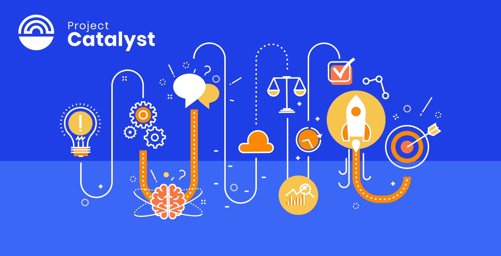
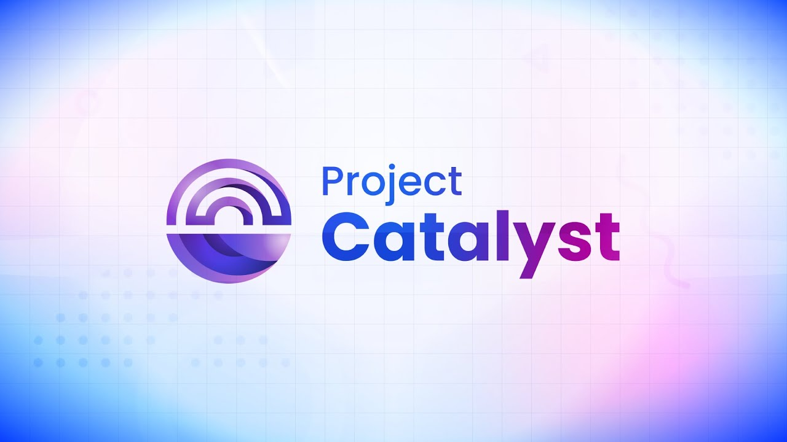
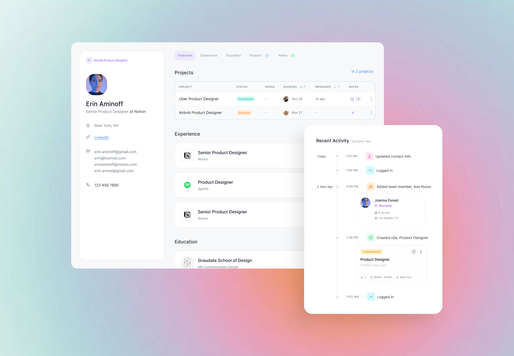
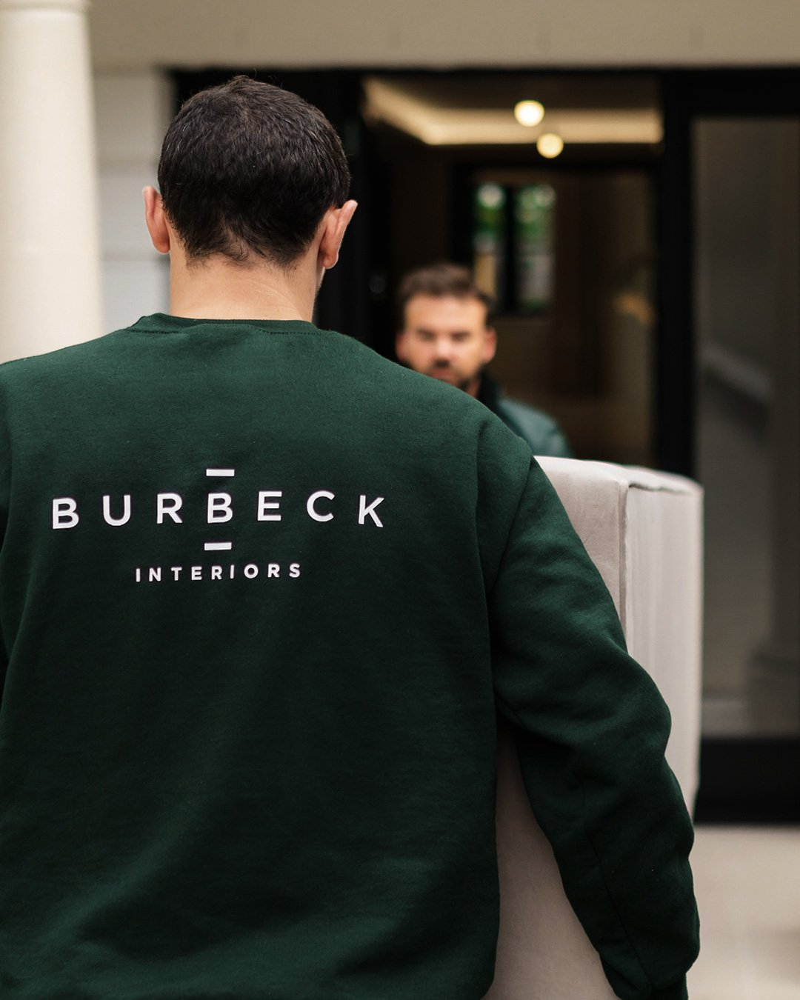

<!-- section: hero -->
# We are digital technology specialists. We are also perfectionists.

We offer full-scale technical design, architecture, and delivery of digital products what will help your business flourish. Our capabilities meet even the most demanding requirements.

Over the years, we’ve delivered a multitude of projects, from **complete global rebrands** to helping governments' architecture and launch **critical national infrastructure**.

<!-- section: showcase (rotating slideshow) -->

**Daniel Ricciardo** — A complete relaunch of Daniel Ricciardo's (AKA The Honey Badger) online home.

**Project Catalyst** — We worked with Project Catalyst to launch a complete rebrand, oversee several fund launches and overhaul their backend processes.

**Palatine Homes** — A fresh, vibrant relaunch for Palatine Homes.

**Eversys** — We worked in collaboration with Big DB to deliver a complete, multinational relaunch for Eversys.

<!-- section: featured -->
## Featured

- [Project Catalyst](/work/project-catalyst) 
- [Betterleap](/work/betterleap) 
- [Burbeck](/work/burbeck) 

<!-- section: services -->
## What we offer.

We don't design your products, offer business strategy, or anything else. We only offer one service. Delivering fast, reliable, and scalable technical solutions for your business.

### Web Development

We can take your designs and requirements and turn them into a blazing fast, secure and reliable web application, which functions across all popular devices.

### API Development

Whether it be designing and implementing a brand new API for your company to use, or optimising existing solutions through the use of new technologies such as GraphQL, we can help.

### Mobile Development

Utilising the latest in mobile browser technologies, and cross platform solutions, we can develop and launch fast, mobile-first web-based products that excell across all modern devices.

### Security & Penetration Testing

Our team are trained in all the lastest web vunlerabilites and web-app penetrating testing, that allows use to asses existing applications and provide advice on how to better secure your products.

<!-- section: engagement_models -->
## How we work.

There are a multitude of ways we can collaborate and help our clients.

### End-to-end Build

We can take your designs and requirements, and turn them into a living, breathing, product or experience - guiding you the whole way.

### Consulting

If you have hit a roadblock, or are struggling with in-house technical process or deliverables, we can help get you back on track.

### Partner Up

Got an in-house technical team, but need some immediate technical expertise, or extra talet to help meet a deadline? We hit the ground running, and can speed up deliverables almost overnight.

<!-- section: call_to_action -->
Want to know more? Get in touch with us at [hello@nrthpoint.com](mailto:hello@nrthpoint.com), or have a read of our founder, Harry Northover's [personal blog](https://northover.co).

<!-- section: footer -->
© 2025 North Point Technology. All rights reserved.
