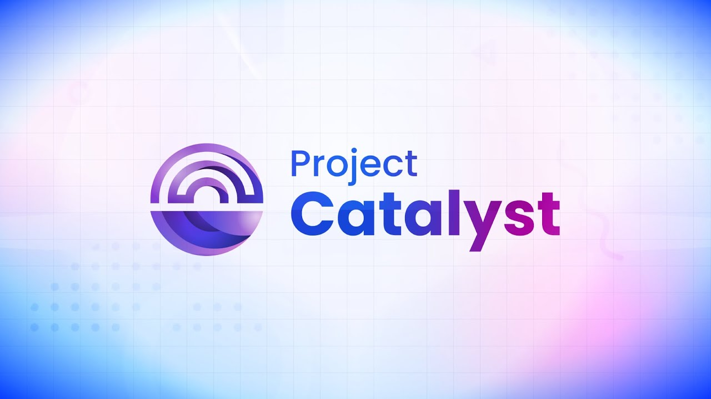
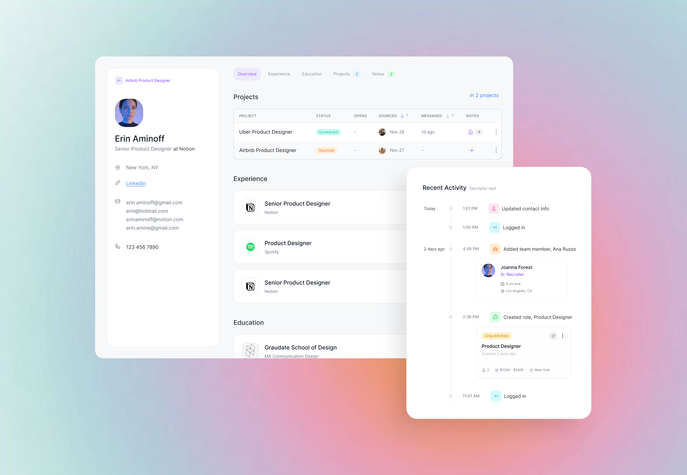
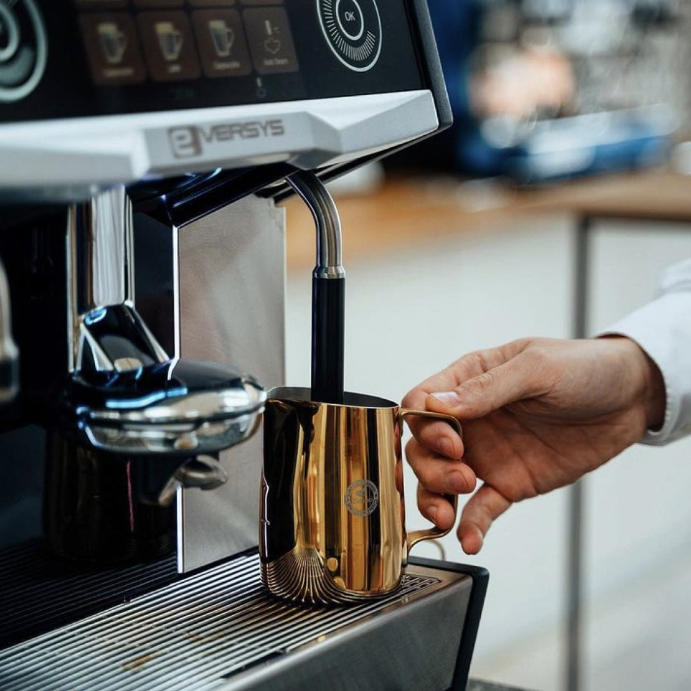
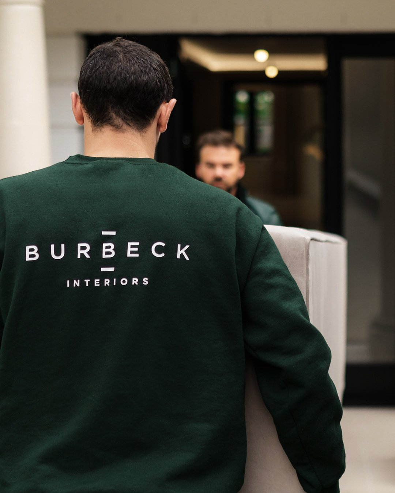
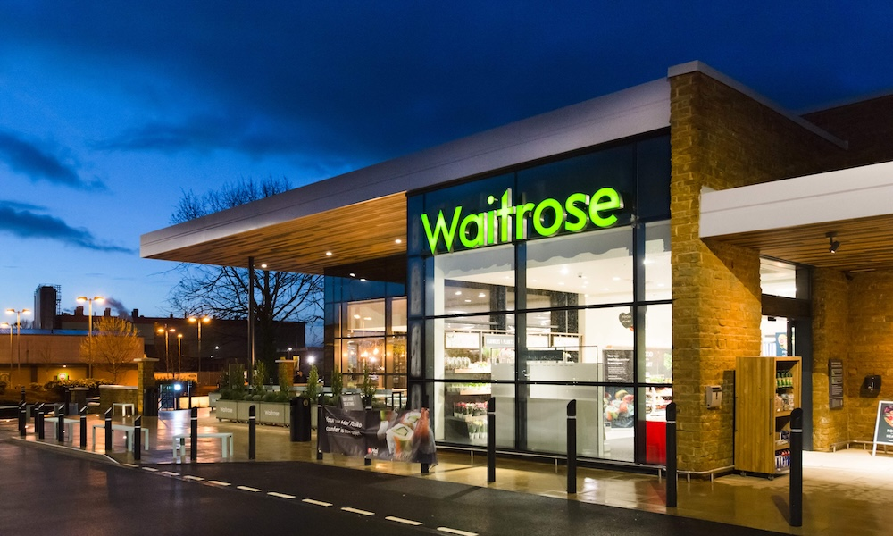
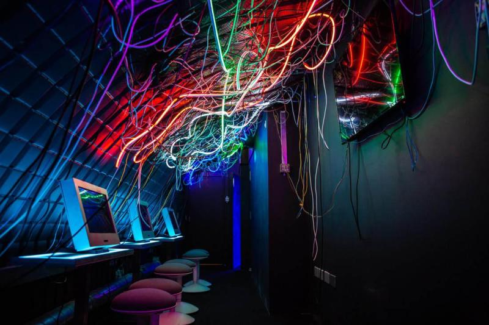

# Our Work

## Project Catalyst

We worked with Project Catalyst to launch a complete rebrand, oversee several fund launches and overhaul their backend processes.

## Daniel Ricciardo

A complete relaunch of Daniel Ricciardo's (AKA The Honey Badger) online home.

## Betterleap

We partnered with Kind.dev and Betterleap to deliver innovative, real-time collaboration tools to their healthcare recruitment platform

## Eversys

We worked in collaboration with Big DB to deliver a complete, multinational relaunch for Eversys.

## Palatine Homes

A fresh, vibrant relaunch for Palatine Homes.

## Burbeck

Rebrand for luxury property development & interior design company Burbeck.

## Waitrose

We worked in-house with Waitrose to re-launch several integral parts of their online shopping experience.

## UK Home Office

Rebuilding parts of the UK's critical national infrastructure for the Home Office.

## Sky

Helping to deliver a new version of NBCUniversal streaming service Peacock.

## Tiney

We helped provide technical consultancy to Tiney, launching the development of both their consumer-facing app as well as the admin capabilities for their childcare providers.

## The Grid

We helped craft a one-of-a-kind escape room, partnering with Lollipop to launch The Grid.

## Shell Remote Sense

We provided technical leadership in-house with Shell and IBM to deliver the first version of a new lubricate monitoring service for equipment in the field.

© 2025 North Point Technology. All rights reserved.
