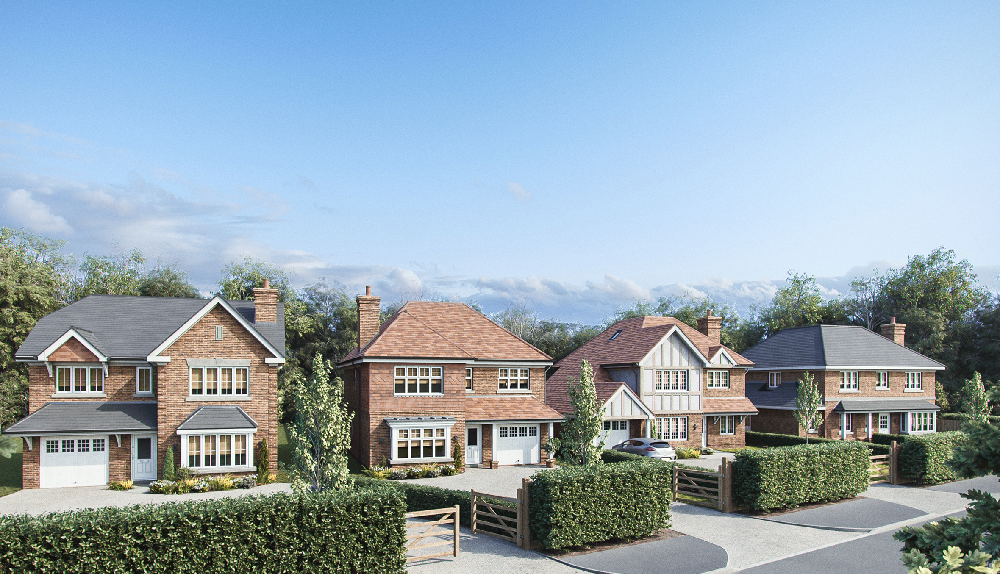
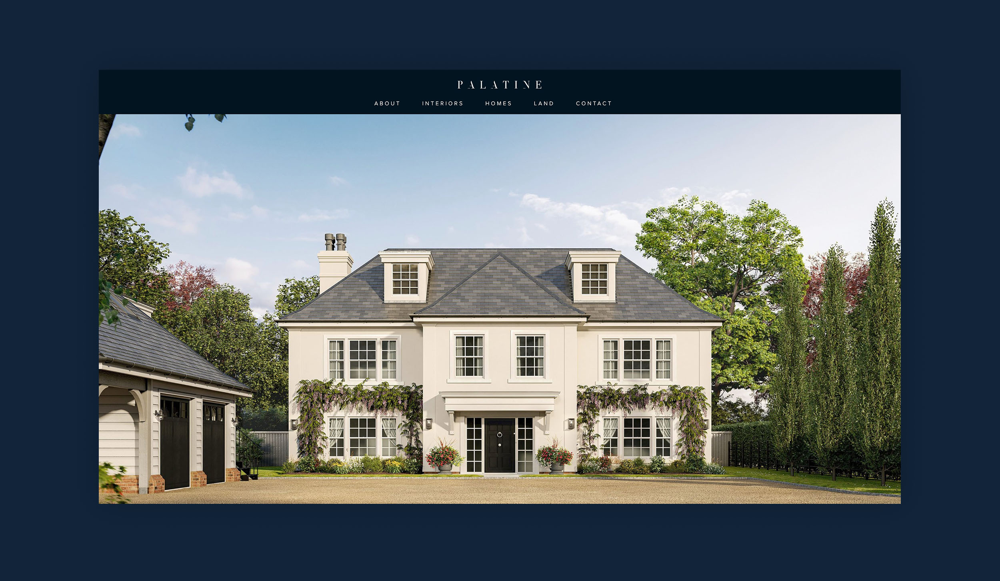
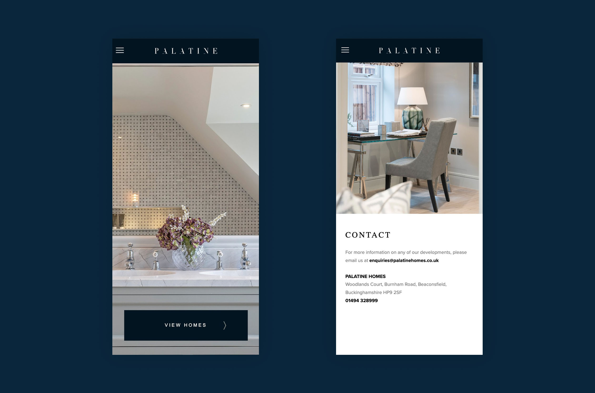
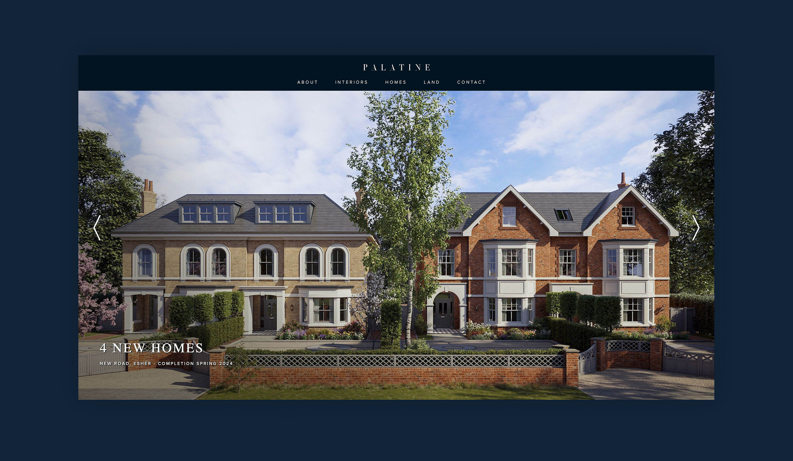
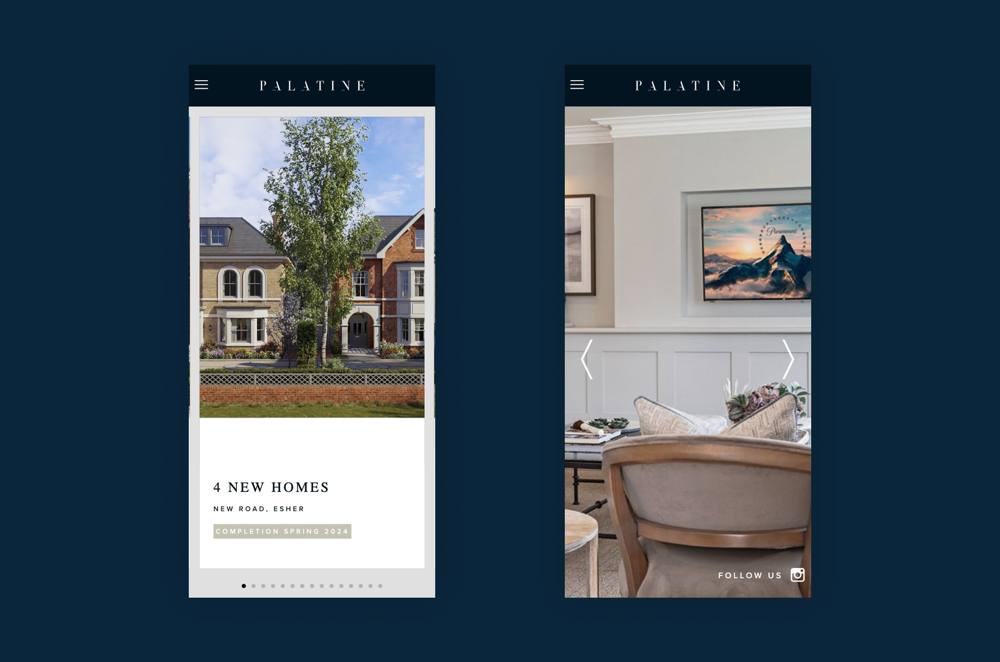
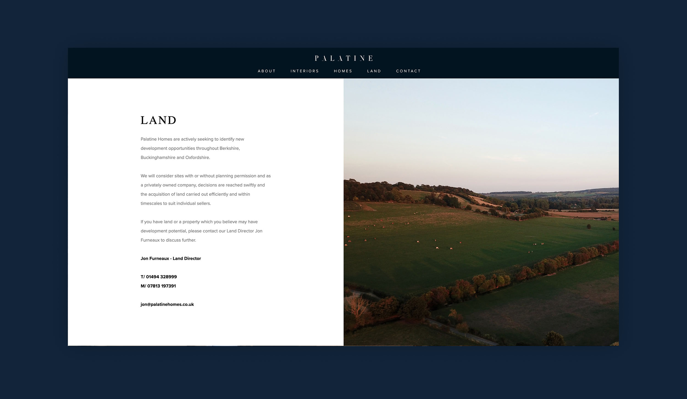

We collaborated with [BSTN LDN](https://www.bastianldn.com) to deliver a new digital presence for property development company Palatine Homes.

We launched the site on [Squarespace](https://squarespace.com), allowing us total freedom regarding the front-end experience and a seamless, intuitive experience for the content editors managing the site. Our project setup followed the usual process for a Squarespace template: a local environment setup with [Squarespace Toolbelt](https://github.com/Squarespace/squarespace-toolbelt) and Webpack, Sass and Babel to utilise the latest front-end standings, then build a bundle ready for upload to Squarespace.

[visit →](https://www.palatinehomes.co.uk)
