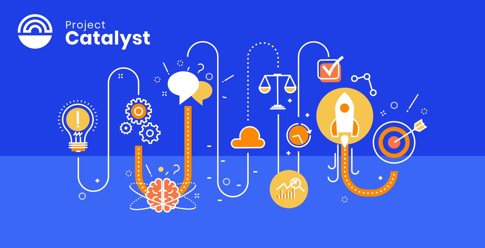
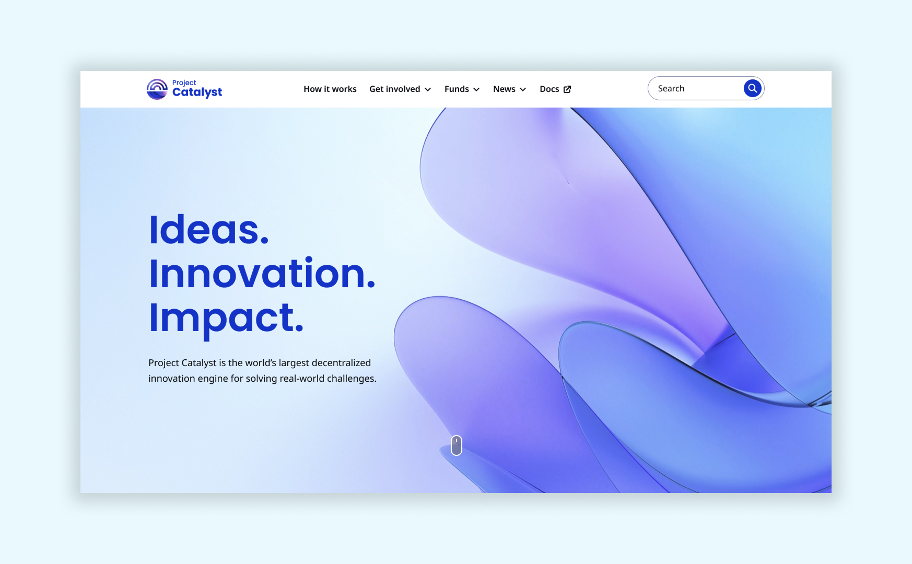
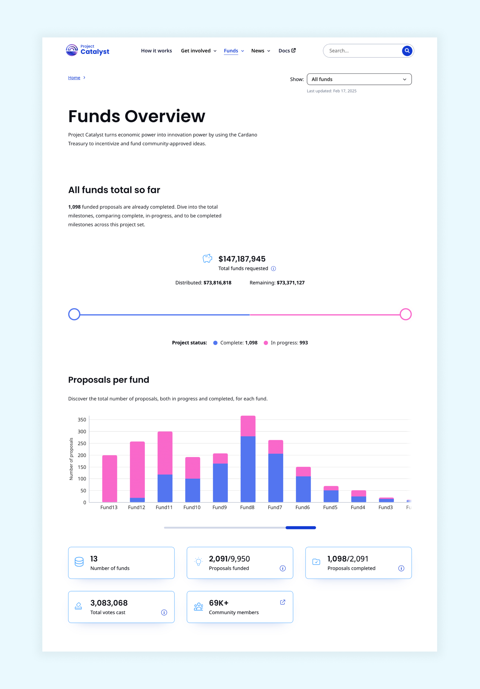
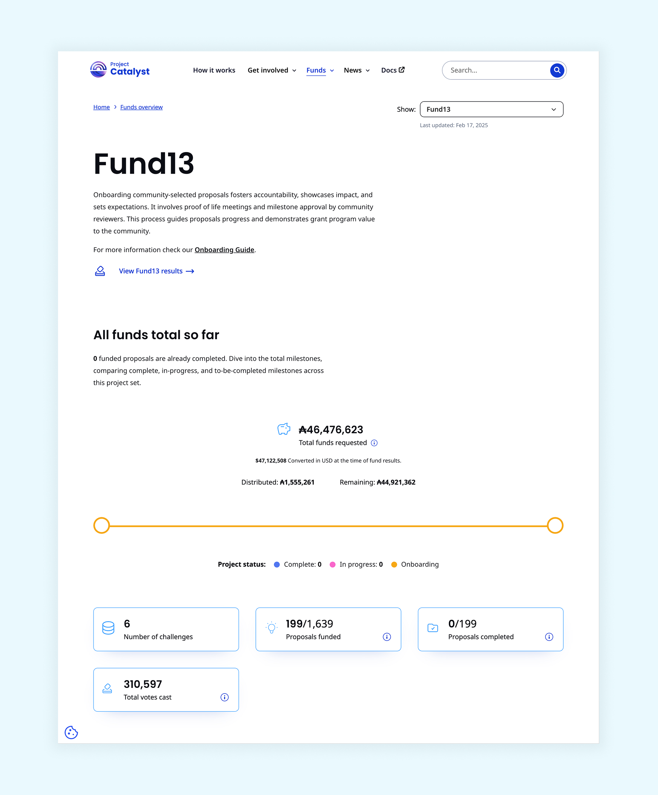
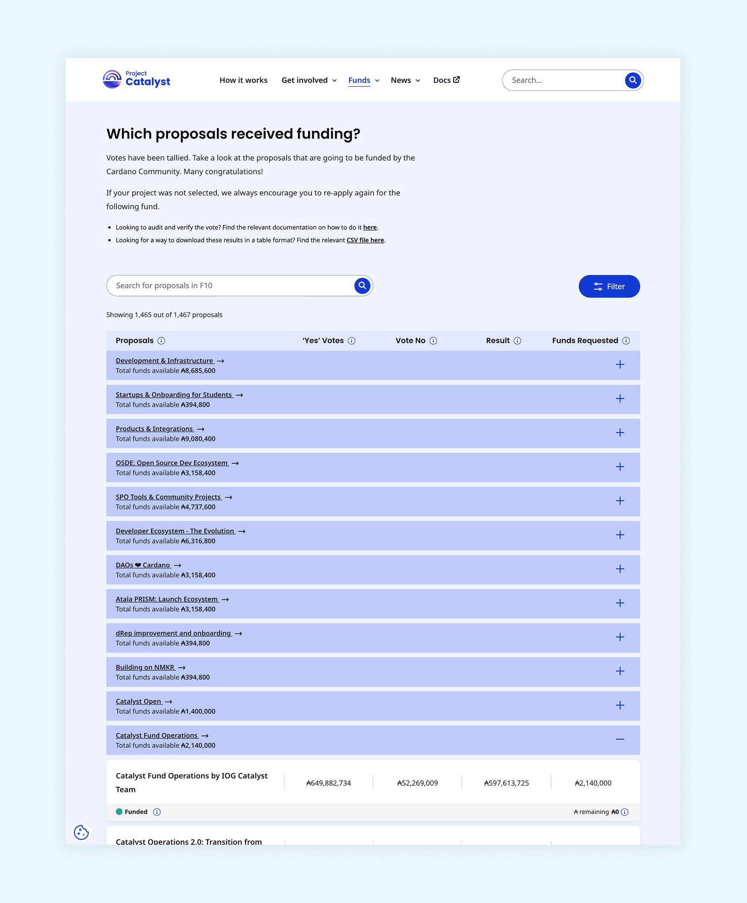
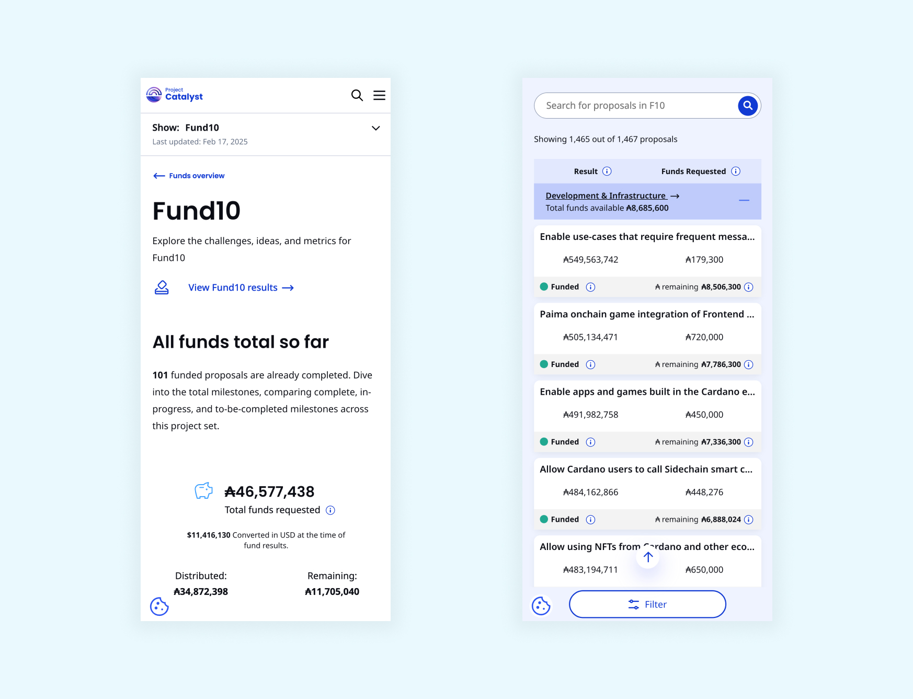
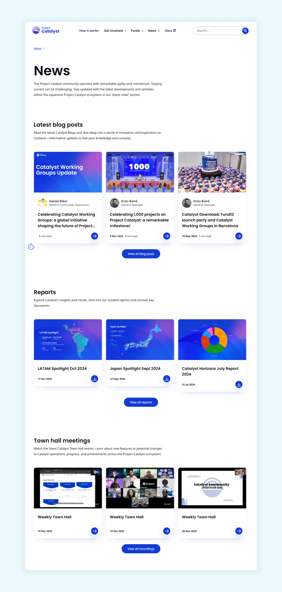
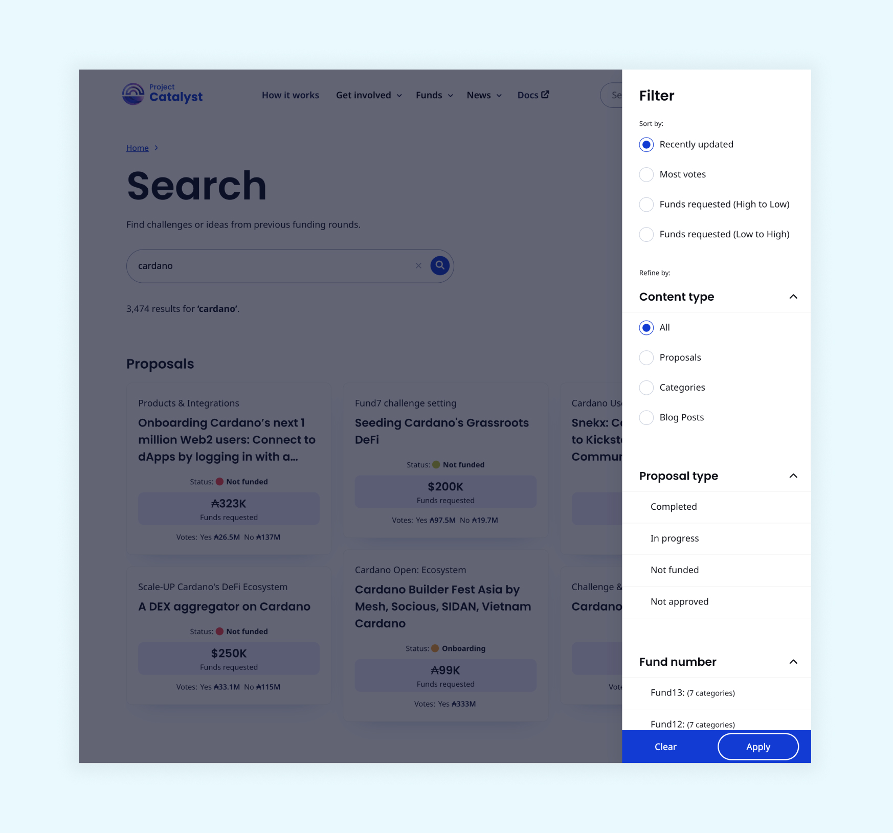

We partnered with Project Catalyst to lead development of a complete rebrand, oversee multiple fund launches, and modernize their backend architecture to integration with their internal systems. Working closely with creative and product teams, we ensured a seamless integration of technical and business functions.

We led the migration of their backend processes to new, automated systems, implementing CI/CD pipelines to streamline deployments and improve efficiency. The front-end made use of GraphQL to integration several different backend tools such as Algolia and MongoDB. Our work not only supported the rebrand but also positioned Project Catalyst for future growth with a more agile and automated infrastructure.

[visit →](https://projectcatalyst.io)
